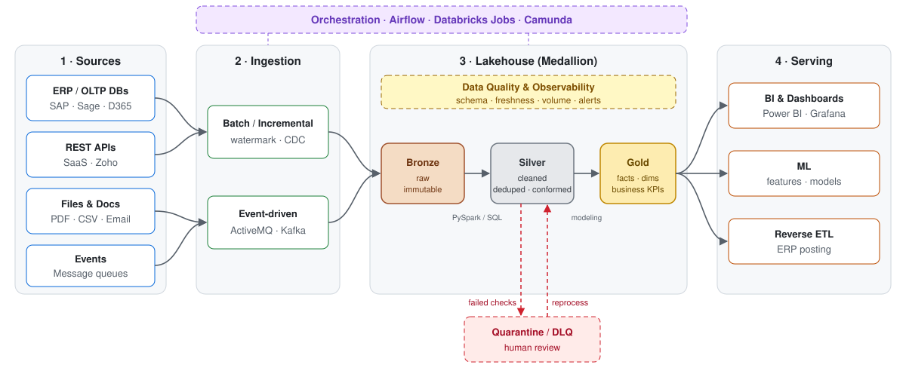

<h1 align="center">Hi, I'm Bharat V 👋</h1>
<h3 align="center">Data Engineer · I build pipelines that turn messy, unstructured data into clean, trusted, analytics-ready data</h3>

  
  
  
  

---

## 🚀 About Me

- 🔧 **Data Engineer** with 3+ years designing and running **end-to-end data pipelines, ETL/ELT workflows and API integrations** for enterprise finance and compliance automation.
- 🌊 Most interested in **data pipelines**: ingestion, transformation, validation, data quality, orchestration and the systems that keep data flowing reliably at scale.
- 📄 Built **LLM/NLP-powered Intelligent Document Processing (IDP) pipelines** that turn unstructured PDFs into structured, validated records and post them into **Sage, SAP, Microsoft Dynamics 365 and Zoho**.
- 🏗️ Currently going deeper into **Apache Spark, PySpark, Databricks and the Medallion (Bronze → Silver → Gold) Lakehouse architecture**.
- 🤖 Strong foundation in **Machine Learning** (scikit-learn, TensorFlow/Keras, NLP) and **data visualization** with **Power BI** and **Grafana**.

---

## 🔄 How I Think About Pipelines

  

**Engineering principles I build pipelines around**

| Principle | What it means in practice |
|---|---|
| **Idempotent & re-runnable** | Every load can be safely replayed: upserts/`MERGE` instead of blind inserts, deterministic keys, no duplicates on retry |
| **Incremental by default** | Watermarks / CDC instead of full reloads, partitioned by date for cheap backfills |
| **Raw data is sacred** | Land source data untouched in Bronze so any downstream bug can be fixed by reprocessing, not re-extracting |
| **Data contracts & schema evolution** | Validate schema at ingestion, handle drift explicitly, fail loudly on breaking changes |
| **Quality gates, not quality hopes** | Null, range, uniqueness and referential checks between layers; bad records quarantined, never silently dropped |
| **Observable** | Track freshness, row counts, latency and failure rates with dashboards and alerts against SLAs |
| **Config over code** | Business rules live in config/metadata so new sources and rules ship without redeploying pipelines |

---

## 🛠️ Tech Stack

**Languages**

  
  
  
  
  

**Data Engineering & Big Data**

  
  
  
  
  
  
  
  

**Databases**

  
  
  

**Cloud & DevOps**

  
  

**Visualization & BI**

  
  
  

**Machine Learning & AI**

  
  
  
  
  

**Integration & Tools**

  
  
  
  
  
  
  

---

## 🏭 Production Pipelines I've Built

| Pipeline | What it does | Scale / Impact | Stack |
|---|---|---|---|
| **Accounts Payable Automation** | Event-driven ingestion from vendor mailboxes → IDP extraction → duplicate detection & 3-way PO/GRN matching → batch posting to ERP | ~200 invoices/day across 4 legal entities · **85% less manual effort** | Python · ActiveMQ · MongoDB · Sage API |
| **Compliance Audit Automation** | Ingests audit sets (wage registers, PF/ESI challans, muster rolls), classifies documents, extracts with LLM, validates against master data | **1,000+ docs & 300+ audits/day** · config-driven rule engine | Python · LLM · MongoDB · Grafana |
| **Utility Bill Automation** | Scheduled scraping across vendor portals → IDP → daily consolidated report → ERP posting | Multi-site, multi-vendor | RPA · IDP · SAP · Dynamics 365 |
| **Procure-to-Pay (PoC)** | Inventory → PO → vendor invoice matching → bill closure, synced via APIs | Near-touchless P2P cycle | Zoho Books · Zoho Inventory · REST |
| **Analytics & Dashboards** | MongoDB aggregation pipelines feeding drill-down dashboards for invoice and audit tracking | Real-time KPIs: volume, throughput, bottlenecks, exceptions | MongoDB · Grafana |

---

## 📂 Featured Repositories

| Repo | Description |
|---|---|
| 🛒 [**retailpulse-data-platform**](https://github.com/Bharatv05/retailpulse-data-platform) | An evolving end-to-end e-commerce data platform for a fictional retail company: ingestion, transformation and analytics layers |
| 🎵 [**Song Recommendation**](https://github.com/Bharatv05/Song-Recommendation-using-Content-Based-Filtering) | Content-based filtering recommender system |
| 🔤 [**OCR – CRNN Model**](https://github.com/Bharatv05/OCR---CRNN-Model) | CRNN model for optical character recognition |
| 🌸 [**Iris Classifier**](https://github.com/Bharatv05/Iris_classifier) | Classic ML classification pipeline |

---

## 🎯 Currently Focused On

- [x] Event-driven & batch ingestion pipelines
- [x] Data validation & data-quality frameworks
- [ ] Lakehouse pipelines with **Databricks + PySpark** (Bronze → Silver → Gold)
- [ ] Workflow orchestration with **Apache Airflow**
- [ ] Data modeling & warehousing (dbt, star schemas)
- [ ] Streaming with **Kafka**

---

## 🎓 Education & Certification

- **M.Sc. Data Science** · Bishop Heber College, Tiruchirappalli (2021–2023)
- **B.Sc. Mathematics** · Bishop Heber College, Tiruchirappalli (2018–2021)

**Certifications**

| Certification | Platform |
|---|---|
| [Big Data Fundamentals with PySpark](https://www.datacamp.com/completed/statement-of-accomplishment/course/1a7cf83d5dfe0c48fdebec73759c91a5cda660fd) | DataCamp |
| [Introduction to Docker](https://www.datacamp.com/completed/statement-of-accomplishment/course/c29971682c373c594c5ab4b6b3001d2ce92ac743) | DataCamp |
| [Using Data Stores in AWS](https://www.datacamp.com/completed/statement-of-accomplishment/course/5d490f2afb09e57362d200947ef60223222b822a) | DataCamp |
| Big Data | NPTEL |

---

## 🤝 Let's Connect

  
  

> *"Good data pipelines are invisible. You only notice them when they break, so I build them not to."*
